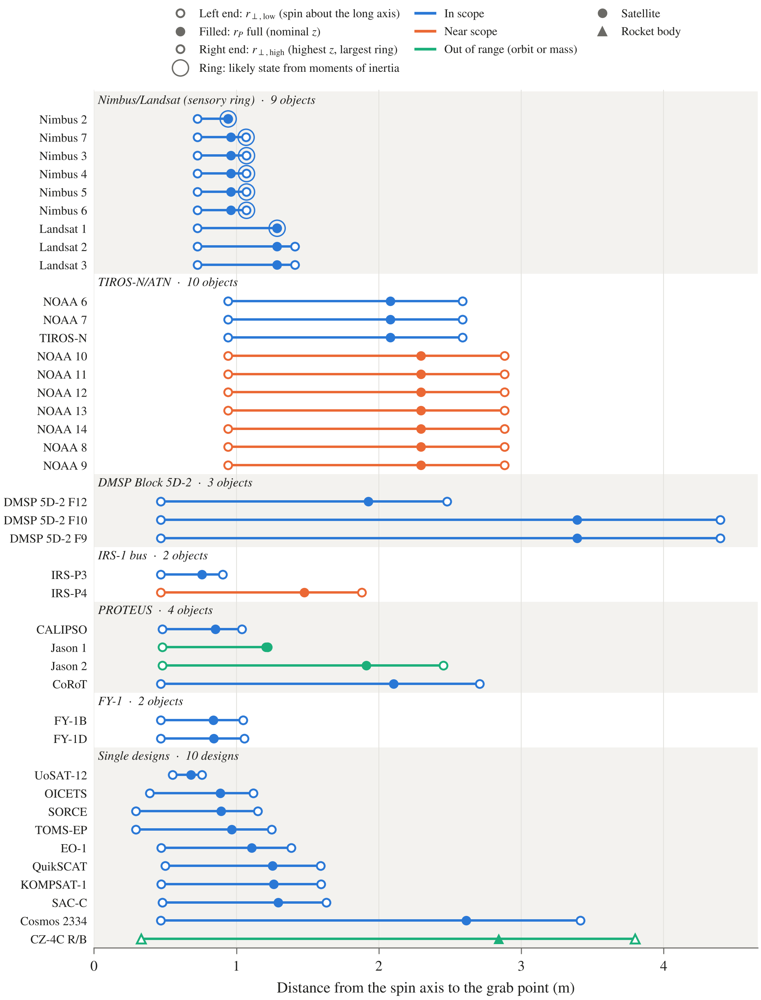
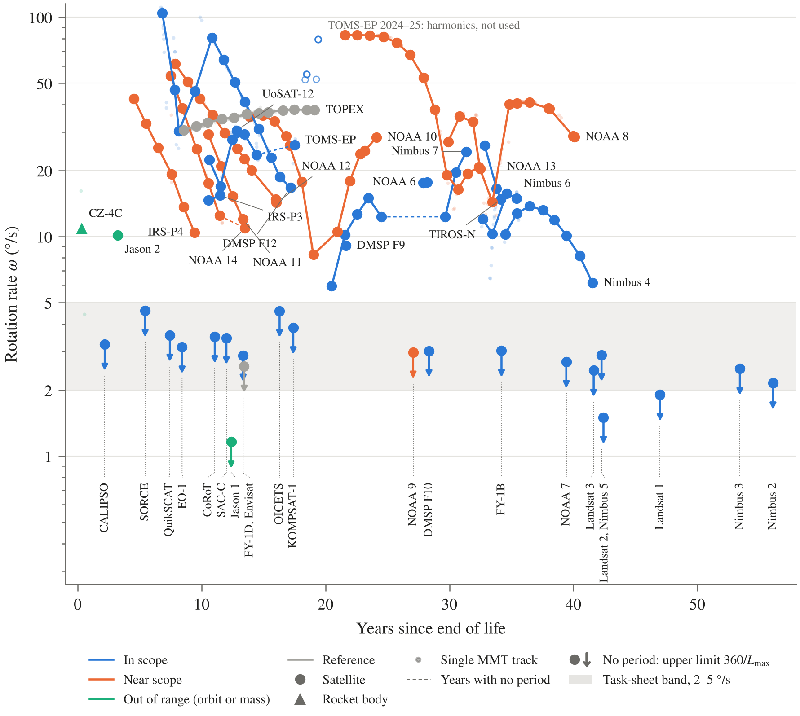

# HARMONIA figures

Python scripts that make the figures for the dataset. They read straight from the workbook and the MMT pull, so if the data changes I just rerun them and the figures stay up to date. Everything comes out as a 300 dpi PNG that fits a full page width (7 in).

## Setup

Same packages as `mmt_rotation`, so if that already runs you're set. Otherwise:

```
py -m pip install -r ..\mmt_rotation\requirements.txt
```

## Running

From this folder in PowerShell. I put the paths in variables so there's only one place to change if the workbook gets renamed:

```powershell
$wb = "..\..\HARMONIA_data_v1.2.xlsx"
$tr = "..\mmt_rotation\data\pull_2026-10-24\mmt_tracks.csv"

py fig1_rp.py $wb
py fig2_rate.py $wb $tr
py fig2_rate.py $wb $tr --part periods
py fig2_rate.py $wb $tr --part limits
```

**Open the workbook in Excel and save it before running fig1.** The r_P columns are formulas, and the script can only read the values Excel last calculated. If a script edited the workbook since then, those values are gone and fig1 will stop and tell you. Fig 2 only reads typed cells so it doesn't care.

## fig1_rp.py

This one shows: how far the grab point is from the spin axis for each object.

Each row is one object. The line goes from r⊥ low (left end, spinning about the long axis) to r⊥ high (right end, highest z and largest ring), and the filled dot is r_P full. The rows are grouped by bus family from the Master tab, and anything that's the only one of its design goes under "Single designs". The ring around a dot is the likely spin state, which I only have for the objects with published moments of inertia (Nimbus and Landsat 1).

Colour is scope (In scope, Near scope, Out of range) and the shape is the object type (circle for satellites, triangle for rocket bodies). Reference and Not intact objects are left out. Anything without r_P yet gets left out too, and the script prints its name.



## fig2_rate.py

This one shows: how fast each object spins against how long it's been dead.

The faint points are single MMT tracks with a period, and each object's line goes through its yearly medians (dashed where there's a gap of a year or more with no period). Objects that never gave a period are upper limits: a dot at 360 / (longest track) with an arrow pointing down, since the real rate has to be slower than that. Their names hang off one line at the bottom, and objects at the same x share a label. The grey band is the 2 to 5 °/s range from the task sheet.

For TOMS-EP the later years are harmonics (see the Light curve tab), so anything after the year I set by hand is drawn hollow and left out of the line.



The two `--part` options split fig 2 into supporting plots that are easier to read:
- `--part periods` (fig2_periods.png): only the objects with a measured period.
- `--part limits` (fig2_limits.png): only the objects with no period. These show both limits, the one from the longest track (the one I use) and the looser one from the median track.

## style.py

The fonts, colours and marker shapes all the figures share. If I want to change how something looks across every figure, it goes here.

## drafts/

Extra figures I'm trying out. They aren't final and the labels still need some cleaning up. Run them from inside `drafts`:

```powershell
cd drafts
py fig3_spin_evolution.py ..\$wb ..\$tr
py fig4_grab_speed.py ..\$wb
py fig5_timeline.py ..\$wb ..\$tr
py fig6_detection.py ..\$wb ..\$tr
```

| Script | What it shows |
|---|---|
| `fig3_spin_evolution.py` | Spin rate over time for the 12 objects with several years of periods, one panel each, with an exponential fit over the spin-down years |
| `fig4_grab_speed.py` | Rotation rate against r_P, with lines of equal grab point speed (v = ωr). Needs the Excel save like fig1 |
| `fig5_timeline.py` | Which years each object gave a period, with the yearly median rate in each cell |
| `fig6_detection.py` | Period found against track length, to show the limit of what MMT can measure |
| `common.py` | Reads the workbook and the tracks CSV for the drafts |

Fig 3 leaves out the DMSP F12 Dec 2016 to Jan 2017 folds (too long) and the Nimbus 7 Jul 2018 track (doesn't fold cleanly). Fig 5 stars every year with a fold I left out: DMSP F12 2016–17, Nimbus 7 2018 and TOMS-EP 2016 and 2024–25. The reasons are in the Factor-of-2 comments on the Light curve tab. Fig 2 still has the DMSP F12 2016–17 and TOMS-EP Aug 2016 folds in its lines, it only drops the TOMS-EP years after 2023.

## Quick check

If everything ran right:
- fig1 prints `40 objects in 7 blocks`.
- fig4 prints that Cosmos 2334 was left out (it has r_P but no MMT rate yet).
- fig6 prints a minimum of about 1.2 cycles per track.
