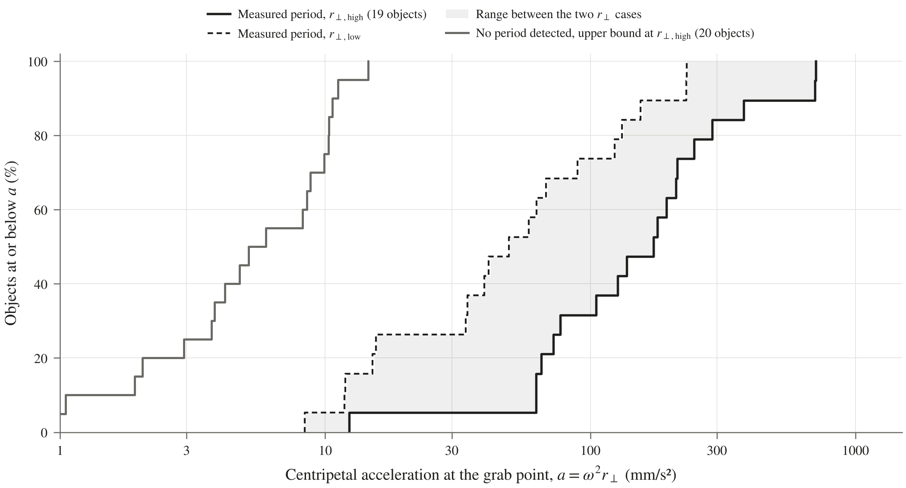

# HARMONIA figures

The scripts that make figures 1 to 7 for the dataset. They read straight from the workbook and the MMT pull, so if the data changes I just rerun them and the figures update. Each one saves a 300 dpi PNG into `plots/` that is exactly 7 in wide (full page width).

## What's in this folder

```
figures/
├── fig1_rp.py               Fig 1: grab-point distance per object
├── fig2_rate.py             Fig 2: rotation rate vs years since end of life (+ 2 supporting plots)
├── fig3_spin_evolution.py   Fig 3: spin rate over time, one panel per object
├── fig4_grab_accel.py       Fig 4: rotation rate vs r⊥, with lines of equal centripetal acceleration
├── fig5_timeline.py         Fig 5: which years each object gave a period
├── fig6_detection.py        Fig 6: period found vs track length (what MMT can measure)
├── fig7_accel_cdf.py        Fig 7: share of objects at or below each grab-point acceleration
├── table1_rp_width.py       Table 1: which input sets the r⊥ width
├── explore_trends.py        exploratory plots (plots/explore/) and the Findings and Sampling Bias numbers
├── style.py                 fonts and font sizes, colors, markers, legend style, and how plots are saved
├── common.py                reads the workbook and the tracks CSV (figs 3 to 6)
├── left_out.py              reads the list of left-out folds (figs 2, 3, 5, 6)
├── tables/                  CSVs of the memo tables
└── plots/                   the current PNGs
    ├── explore/             exploratory PNGs from explore_trends.py
    └── archive/             the Week 6 PNGs, from before the 13 Nov 2026 style update
```

## Style

All seven figures follow the same rules so they look like one set in the paper:

- Exactly 7 in wide (full page width), 300 dpi, STIX serif font to match the paper text. `save()` in `style.py` widens or narrows each figure until its tight crop is 7 in, so every PNG prints its text at the same size when they are placed at the same width.
- One set of font sizes, `FS` in `style.py`: axis labels 9 pt, tick labels 7.5, panel titles 8, legend 7, object names down the side (figs 1 and 5) 7, labels and notes inside the plot 6.5, and the numbers in the fig 5 cells 5.6. No script sets its own size.
- Legend above the plot, centered, no frame (`legend_top` in `style.py`). No titles inside the figures; that goes in the caption. Panel figures name each panel above it.
- Same colors for scope everywhere (blue in scope, orange near scope, green out of range, gray reference), circles for satellites and triangles for rocket bodies. Fig 7 doesn't split by scope, so it uses black and dark gray instead of the scope colors.
- Grid lines are the same light gray and 0.4 pt wide (`GRID_LW`) wherever a figure has them.
- Axis labels are "Quantity, symbol (unit)", e.g. "Rotation rate, ω (°/s)". Log axes show plain numbers and no minor ticks.
- The gray band is always the 2 to 5 °/s range from the task sheet, and left-out folds are always hollow.
- Figure text only describes what's shown, for a reader with no project context: no internal terms like "task sheet", "fold", "track" or "in scope". The legend says "Assumed rotation range", "Excluded period", "Light curve" and "Within mass and orbit limits" instead; the caption explains the rest.

## Setup

Same packages as `mmt_rotation`, so if that already runs you're set. Otherwise:

```
py -m pip install -r ..\mmt_rotation\requirements.txt
```

## Running

1. **Open the workbook in Excel and save it.** The r_P, r⊥ and detection limit columns are formulas, and Python can only read the values Excel last calculated. If a script has edited the workbook since then, those values are empty: fig1 stops and tells you, and fig4 leaves objects out.
2. From this folder in PowerShell (the paths are in variables so there's only one place to change if the workbook gets renamed):

```powershell
$wb = "..\..\HARMONIA_data_v2.xlsx"
$tr = "..\mmt_rotation\data\pull_2026-10-24\mmt_tracks.csv"

py fig1_rp.py $wb
py fig2_rate.py $wb $tr
py fig2_rate.py $wb $tr --part periods
py fig2_rate.py $wb $tr --part limits
py fig3_spin_evolution.py $wb $tr
py fig4_grab_accel.py $wb
py fig5_timeline.py $wb $tr
py fig6_detection.py $wb $tr
py fig7_accel_cdf.py $wb
py table1_rp_width.py $wb
```

The PNGs always go to `plots/`, wherever you run the scripts from. Add `--out path.png` to save one somewhere else.

3. Check the printed lines. If everything ran right:
   - fig1 prints `40 objects in 7 blocks`.
   - fig3 prints `TIROS-N: fit 2014-2016, 3 yearly points`.
   - fig4 prints `Measured objects: a from 8 to 708 mm/s^2` and that Cosmos 2334 was left out (it has r_P but no MMT rate yet).
   - fig6 prints a minimum of 1.21 cycles per track, 5% at 1.89.
   - table1 prints `Main input over all 40 objects: {'CoM band': 28, 'Spin axis': 12}`.
   - fig7 prints `measured (19): a from 8 (r_perp low) to 708 (r_perp high) mm/s^2`, `in scope only (10): r_perp high max 288` and `no period (20, upper bound, r_perp high): 1 to 15`.

## The figures

### Fig 1: grab-point distance (`fig1_rp.py` → `fig1_rp.png`)

Each row is one object. The line runs from r⊥ low (left end, spin about the long axis) to r⊥ high (right end, highest z and largest ring). Both ends are measured **from the spin axis**. The filled dot is r_P full, measured **from the center of mass**. A ring marks the likely spin state, which I only have for the objects with published moments of inertia (Nimbus and Landsat 1).

Rows are grouped by bus family from the Master tab; a design with only one object goes under "Single designs". Color is scope (In scope, Near scope, Out of range) and shape is object type (circle = satellite, triangle = rocket body). Reference and Not intact objects aren't shown, and anything without r_P yet is left out with its name printed.


### Fig 2: rotation rate vs years since end of life (`fig2_rate.py` → `fig2_rate.png`)

Faint points are single MMT tracks with a period. Each object's line goes through its yearly medians, dashed across a gap of a year or more with no period. Hollow points are left-out folds (see *Left-out folds*); they aren't in the medians.

Objects that never gave a period are upper limits: a dot at 1.2 × 360 / (longest track) with an arrow down, since the real rate must be slower (see *Detection limit*). Their names hang off one line at the bottom, and objects at the same x share a label. The gray band is the 2 to 5 °/s range from the task sheet.


Two supporting plots split Fig 2 so it's easier to read:
- `--part periods` → `fig2_periods.png`: only the objects with a measured period.
- `--part limits` → `fig2_limits.png`: only the objects with no period. Filled dot = the stated limit (1.2 cycles), hollow dot = the typical case (1.9 cycles).

### Fig 3: spin evolution (`fig3_spin_evolution.py` → `fig3_spin_evolution.png`)

Spin rate over time for the 12 objects with several years of periods, one panel each on the same log axis. The dashed line is an exponential fit over the spin-down years, labeled with its e-folding time τ (or % per year for a spin-up). Fits on fewer than 4 yearly points are dotted gray and labeled "indicative" (only TIROS-N, 3 points). Ticks along the bottom are years with tracks but no period. The fit years for each object are in `PANELS` at the top of the script.

### Fig 4: grab-point acceleration (`fig4_grab_accel.py` → `fig4_grab_accel.png`)

Rotation rate against r⊥, in two panels with the same x-axis: (a) objects with a measured period, at their latest-year rate, and (b) objects with no period, at their detection limit with an arrow down. Each object is a line from r⊥ low to r⊥ high, and the ring marks the likely spin state, as in Fig 1. Names sit in a column on the right, joined to the end of each line by a faint leader, so no label covers the data.

The dotted lines are equal centripetal acceleration, a = ω²r⊥, at 1, 3, 10, 30, 100, 300 and 1000 mm/s². A servicer holding station beside the grab point needs a thrust of (its mass) × ω²r⊥, so each line is a thrust per kg of servicer. The script prints a for every measured object (8 to 708 mm/s²).

### Fig 5: timeline (`fig5_timeline.py` → `fig5_timeline.png`)

Which years each object gave a period in MMT, 2014 to 2025. Blue cells show that year's median rate in °/s, using only the kept folds. Gray = tracks but no period, blank = no tracks. `*` = some folds that year were left out; an outlined cell with a dash = all of them were. The % after each name is the share of tracks with a period.

### Fig 6: what MMT can measure (`fig6_detection.py` → `fig6_detection.png`)

Period found against track length for every track with a period. A period only shows if at least about 1.2 cycles fit in the track, so all points sit below P = L/1.2, and 95% sit below P = L/1.9. Large dots are the last period seen before an object went quiet for 3+ years. Hollow points are left-out folds; they still count in the cycles-per-track numbers, because the question here is what MMT can detect, not whether the period is the real rotation.

### Fig 7: grab-point acceleration CDF (`fig7_accel_cdf.py` → `fig7_accel_cdf.png`)

The share of objects at or below each centripetal acceleration at the grab point, a = ω²r⊥. Read across from an acceleration a capture system can handle to get the share of objects it covers. Measured objects are drawn twice, at r⊥ high (solid) and r⊥ low (dashed), with the range between them shaded. Objects with no period are drawn at their detection limit with r⊥ high, so their line is an upper bound. Reference and not-intact objects are left out, as in Fig 4, which is why it shows 19 measured and 20 no-period objects. The script prints the range and percentiles used in the memo text.



## Table 1: r⊥ width (`table1_rp_width.py` → `tables/table1_rp_width.csv`)

Shows which input sets most of each object's width, r⊥ high − r⊥ low. Each input is swung over its full range while the other two stay at nominal (nominal z, nominal ring d), and the change in r⊥ is saved in meters:

- Spin axis case: long axis to transverse axis, √(z² + (d/2)²) − d/2
- CoM height band: z min to z max, √(z max² + (d/2)²) − √(z min² + (d/2)²)
- Ring: ring min to ring max, √(z² + (d max/2)²) − √(z² + (d min/2)²), zero where the ring is known

The CoM band and the ring are tested with spin about a transverse axis, since z doesn't change r⊥ for spin about the long axis. The largest swing is the main input. One row per bus family, in the same order as Fig 1. The script also prints the CoM band each Nimbus and Landsat object would have with the default band, for the memo text.

## Memo numbers (`explore_trends.py`)

Besides the two exploratory plots, the script prints the numbers the memo's Findings and Sampling Bias use. The rank correlations are Spearman's ρ, with tied values given their average rank. It prints five blocks:

- **tau vs size:** τ of the 8 spin-down fits in Fig 3 against dry mass, mean altitude and bus height
- **rate vs size:** latest-year rate of the 19 measured objects against dry mass and bus height
- **objects with no period in their last 2+ years:** last year with a period, last year with any track, last rate, the detection limit of the later tracks, and whether the object was spinning down (with its Fig 3 fit extended to the last observed year), steady or speeding up, or had only one year of periods
- **recommended bands:** how many objects (in scope, all 40) and bus geometries the memo's r⊥, rotation rate and acceleration bands cover. The bands are set at the top of the script.
- **brightness and size:** for the 39 objects with MMT data, the number of tracks, the share of tracks with a period and the longest track, each against mean altitude, bus height and dry mass

## Detection limit

A period only shows when at least 1.2 cycles fit in a track: the fewest behind any period in the pull is 1.21, and 95% of periods have at least 1.9. So for an object with no period:

- **Stated limit:** 1.2 × 360 / (longest track). This is what figs 2 and 4 plot.
- **Typical case:** 1.9 × 360 / (longest track), shown hollow in `fig2_limits.png`.

The factors are `CYCLES` and `CYCLES_TYPICAL` at the top of `fig2_rate.py`. The same 1.2 is in the two detection limit columns of the Light curve tab, so change both if it ever changes.

## Left-out folds

The folds I leave out are listed once, in `../mmt_rotation/left_out_folds.csv` (NORAD ID, date range, reason). Figs 2, 3, 5 and 6 all read it through `left_out.py`, so they always drop the same tracks:

| Object | Left out | Why |
|---|---|---|
| DMSP F12 | Dec 2016 to Jan 2017 | Period is a whole multiple of the real cycle |
| Nimbus 7 | Jul 2018 | Doesn't fold cleanly at P/2, P or 2P |
| TOMS-EP | Aug 2016 | Half the real period |
| TOMS-EP | 2024 to 2025 | Harmonics; the workbook uses 2018 to 2023 |

The full reasons are in the Factor-of-2 comments on the Light curve tab. To leave out another fold, add a row to the CSV (dates are inclusive) and rerun the figures. Every script also takes `--left-out other.csv` to try a different list without changing the real one.
