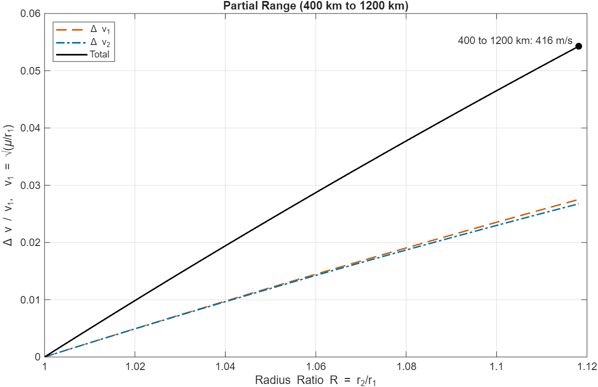
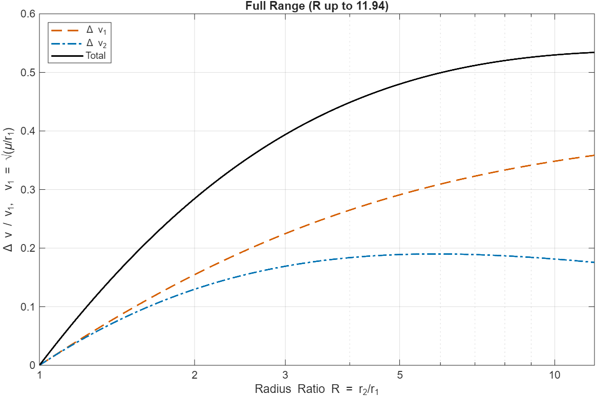
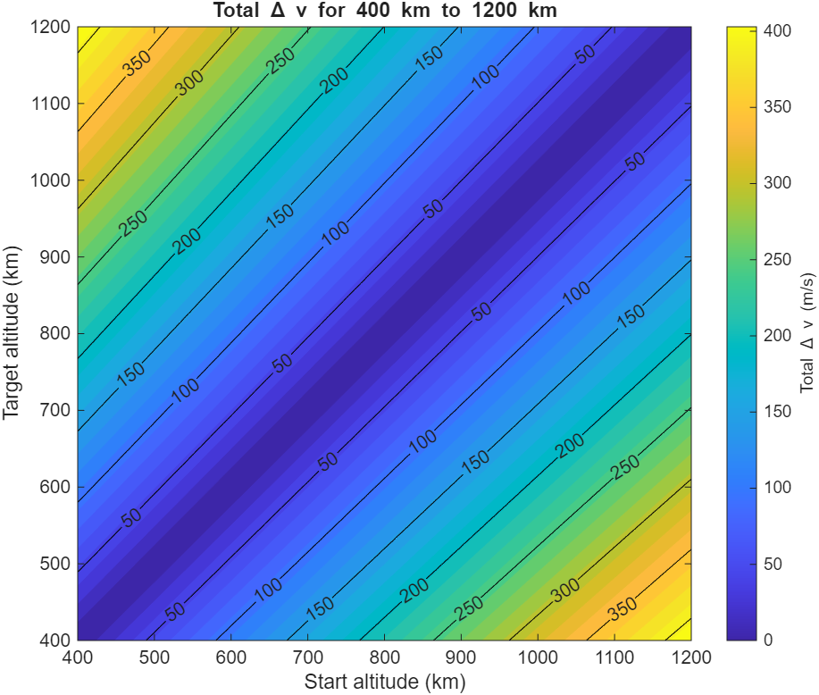
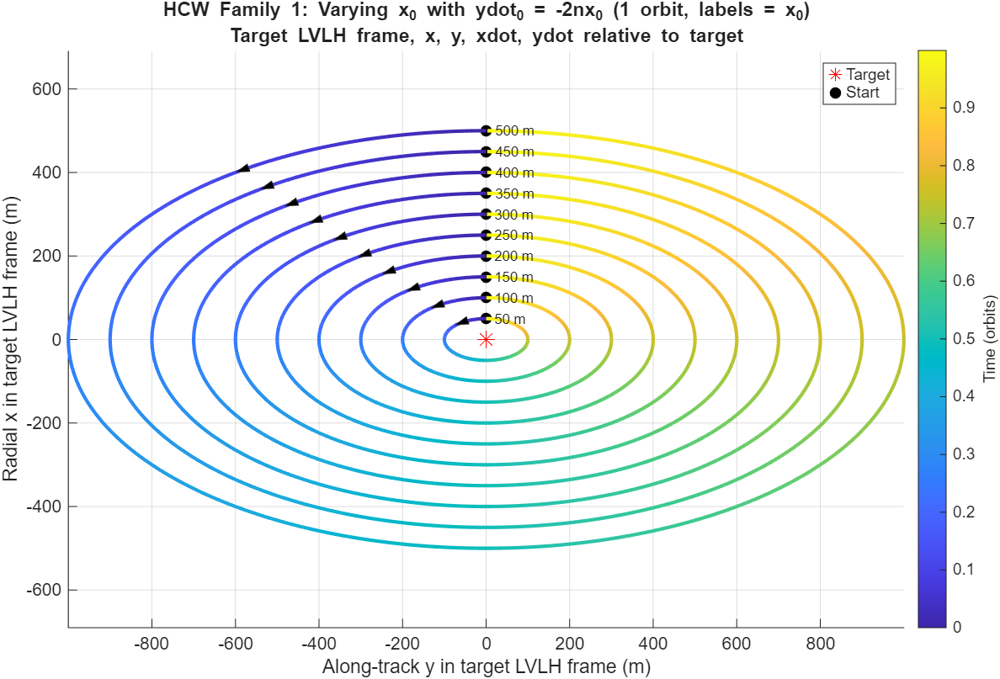
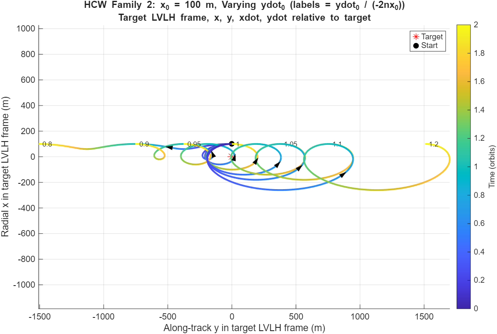
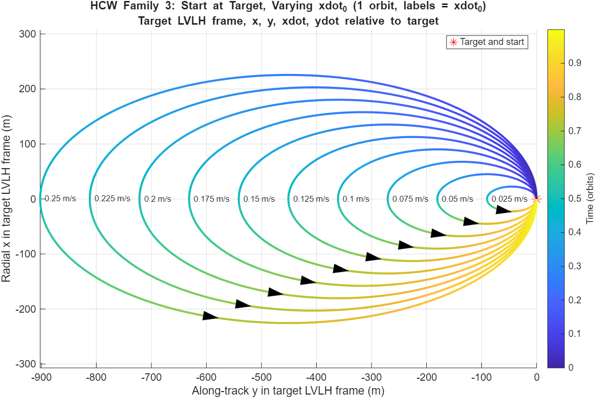

# HARMONIA Week 1: Hohmann and HCW plots

Two MATLAB scripts, `hohmann.m` and `hcw.m`. Open one, press Run, and it makes its figures and saves them as PNGs in the `figures` folder. You need MATLAB R2020a or newer. No toolboxes.

## hohmann.m

This one answers: how much ΔV does it cost to move from one circular orbit to another with a Hohmann transfer?

A Hohmann transfer is two burns. The first puts you on an ellipse that touches both orbits, and the second circularizes you at the target. I got the burn sizes from the vis-viva equation (the speed on the ellipse at each end, minus the circular speed at that end).

I plot ΔV divided by v₁ against the radius ratio R = r₂/r₁, where v₁ is the circular speed at the starting orbit. Dividing by v₁ matters because the raw ΔV depends on where you start, but the divided version is the same curve for any starting orbit.

- **hohmann_partial.png:** the HARMONIA range, from a 400 km orbit out to 1,200 km. It shows both burns and the total. The burns are drawn with different colors and line styles (orange dashed and blue dash-dot) so they can be told apart, and the total is black. Going from 400 km to 1,200 km costs about 416 m/s in total.

  

- **hohmann_full.png:** the same curves for ratios from 1 up to 11.94. I stop at 11.94 because past that a bi-elliptic transfer becomes cheaper than Hohmann. The log axis is labeled at 1, 2, 3, 5 and 10.

  

- **hohmann_contour.png:** the total ΔV in m/s for every start and target altitude between 400 and 1,200 km. It's symmetric because going up costs the same as going down, and it's zero along the diagonal because there is nothing to change.

  

## hcw.m

This one answers: once the servicer is close to the client, how does it move relative to the client?

I used the Hill-Clohessy-Wiltshire (HCW) equations. They describe the servicer's position relative to the client in a frame that sits on the client and rotates with its orbit. In that frame, x is radial (up, away from Earth) and y is along-track (the direction of travel). The client is on a circular orbit at 500 km, and I only look at the in-plane motion.

The HCW equations can be written as a matrix that takes the starting state [x, y, xdot, ydot] straight to the state at any later time. So for each case I pick a starting state, apply the matrix at every time step, and plot y against x.

I plotted three families. In each, one thing changes and everything else stays fixed:

- **Family 1:** the starting radial offset x₀ changes (50 to 500 m), and the along-track velocity is set to -2n·x₀. That is the condition for no drift, so each path is a closed ellipse that is twice as long as it is tall.
- **Family 2:** x₀ stays at 100 m and the along-track velocity is scaled to 0.8 up to 1.2 times that no-drift value. Anything off 1.0 drifts along-track, and the further off, the faster it drifts.
- **Family 3:** the servicer starts on top of the client and gets a different radial velocity each time (0.025 to 0.25 m/s). These are also closed ellipses.

How to read the figures: the color along each path is time, shown on the bar at the side. The black triangle on each path points the way the servicer is traveling. The text labels give the value that was changed for that path. Families 1 and 3 show one orbit, because they are closed and a second orbit would just trace over the first. Family 2 shows two orbits so the drift is visible.

HCW only holds when the two spacecraft are close together, so these plots are meant for separations of up to a few kilometers. It also ignores drag and J2.

## Quick check

If the scripts ran correctly, these should match:
- The 400 to 1,200 km Hohmann transfer costs about 416 m/s.
- In Family 2, the 0.8 case drifts about 1,500 m along-track over 2 orbits.
- In Family 3, the 0.25 m/s case reaches about 226 m radially and 904 m along-track.

## Files

| File | What it is |
|---|---|
| `hohmann.m` | Hohmann transfer ΔV plots |
| `hcw.m` | HCW relative motion plots |
| `figures/` | The six PNGs the scripts make |
| `archive/hohmann_old.m` | Earlier version of `hohmann.m`, kept for reference |
